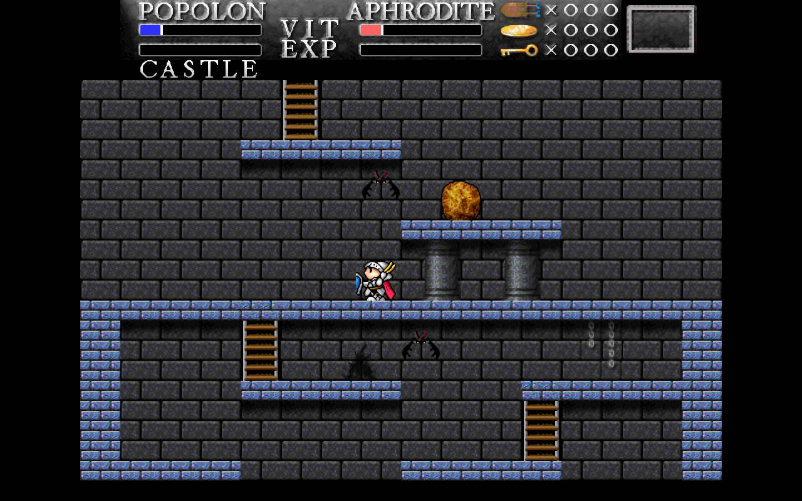
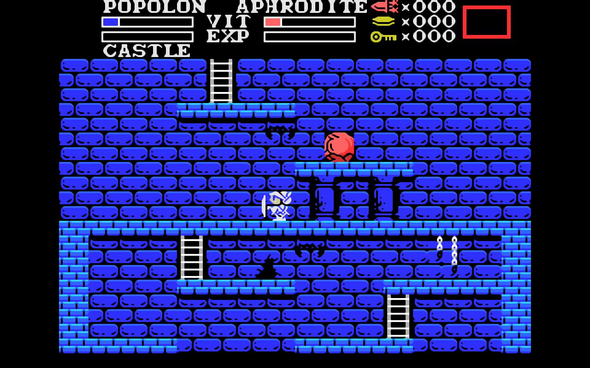

# Maze of Galious for Haiku and RenkuOS

A native Haiku and RenkuOS port of the Brain Games remake of
*Knightmare II: The Maze of Galious*, the 1987 Konami classic for the MSX.

## The game

*The Maze of Galious* was developed and published by **Konami** in 1987
for the MSX computer, with a Famicom version later that year. It is the
second part of the Knightmare trilogy.

Popolon and Aphrodite travel through Castle Greek to free their unborn
child Pampas from the evil priest Galious. The castle is a large maze in
which the entrances to ten worlds are hidden, each with its own map. You
play both heroes and switch between them: Popolon pushes stones, opens
heavy doors and can vary the height of his jump; Aphrodite stays under
water longer and fires more projectiles. Along the way you collect
weapons, items, keys and money, and you visit shrines for help and to
save the game.

The original game is © 1987 Konami. This project is not affiliated with
or endorsed by Konami.

## The remake

The remake by **Brain Games** (2002 to 2009) keeps the original maps and
gameplay and adds new graphics and music, with several graphic and sound
sets to choose from.

- Website: <https://mog.jorito.net/>
- Coding: Santi Ontañón and Jorrith Schaap
- Graphics: Santi Ontañón, Boltian, Hinox, MP83 and Naramura
- Music and sound effects: Rob Powelse, Jorrith Schaap, Bart Roijmans,
  Wolf_ and Randy Wintjes
- Maps: Santi Ontañón

This port is based on the last nightly source snapshot of the remake,
`mog-svn-20120228` from the Brain Games nightlies
(<https://braingames.jorito.net/nightlies/>), whose game code matches
release 0.63 (build 1548). The unchanged snapshot is kept in
`upstream/nightly-20120228/`.

## What this port changes and adds

The remake was written for SDL 1.2 with SDL_mixer, SDL_sound and
SDL_image. This port replaces all of that with the native Haiku API, adds
features that make it nicer to play on a modern screen, and fixes some
bugs. The game logic itself is unchanged: an automated test plays a
scripted 1400-frame session and compares every frame with the original
SDL version, and they are identical.

**Native Haiku / RenkuOS**

- Only the system kits are used: `libbe` (window, keyboard), `libmedia`
  (sound through BSoundPlayer) and `libtranslation` (PNG screenshots). No
  SDL or other external libraries.
- Own sound mixer with WAV and Ogg Vorbis decoding (stb_vorbis included).
- Haiku package (`.hpkg`) with the standard layout and a Deskbar entry,
  plus a separate package with the extra graphic and sound sets.
- New vector (HVIF) application icon.

**Picture**

- The game draws at 640x400. The port scales this to any window size or
  to full screen, keeping the 16:10 shape.
- Three filters, switched with F3:
  - **xBR** (default): Hyllian's xBR-lv2 filter, ported from the libretro
    shader to C++, for smooth outlines that keep the pixel art character.
  - **sharp**: sharp bilinear, crisp pixels at any size.
  - **nearest**: whole-number scaling with black borders.
- The "original" set is 320x200 art stored with doubled pixels; the port
  detects this per set, so xBR works on the real art resolution.
- xBR only recalculates the parts of the picture that changed, and
  spreads a full-screen change (a new room) over a few frames, so the game
  stays smooth even on a virtual machine with one CPU.
- Waits for the screen refresh before drawing where the graphics driver
  supports it.

**Sound**

- High-quality resampling (windowed sinc filter) of the 11 and 22 kHz sound
  sets to 44.1 kHz, instead of linear interpolation.
- Music files are opened without blocking the sound output, so music
  does not stutter on room changes.

**Convenience**

- Starts in a window as large as fits on the screen; the window can be
  resized and zoomed. Alt+Enter switches to full screen.
- Remembers the window size and position, full screen and the chosen
  filter.
- The default sets are graphics **naramura** and music **jorito**.
- Screenshot key (S by default, can be redefined) that saves exactly what
  you see as a PNG file in your home folder.
- Timing display (F4) with filter and drawing time, frames per second and
  the vertical sync state.
- The key screen (K on the title screen) lists the extra keys of the
  port.

**Bug fixes in the remake**

- Crash after the Konami logo when the saved settings named a graphic or
  sound set that is not installed.
- Reading past the end of the set list when fewer sets than expected are
  installed.
- `fclose(NULL)` when a picture file is missing, and some compiler
  warnings.

## Keys

These are the defaults. The game keys and the screenshot key can be
changed with K on the title screen.

| Key | Action |
|---|---|
| Cursor keys | Walk, jump (up), climb |
| Space | Sword |
| M | Secondary weapon |
| F1 | Item screen |
| F2 | Pause |
| F5 to F9 | Save the game in slot 1 to 5 (at the Demeter shrine) |
| Esc | Back to the title screen |
| PgUp / PgDn | Zoom |
| F10 or 9 | Next graphic set |
| F11 or 0 | Next sound set |
| F3 | Next filter (xBR, nearest, sharp) |
| F4 | Show or hide the timing display |
| S | Screenshot |
| Alt+Enter | Full screen on or off |
| F12 or Alt+Q | Quit |

On the title screen, Space starts the game, K redefines the keys and L
lets you enter a password.

## Installing

Download `mazeofgalious-<version>-x86_64.hpkg` from the
[Releases](../../releases) page and double-click it, or in Terminal:

    pkgman install ./mazeofgalious-<version>-x86_64.hpkg

The optional package `mazeofgalious_extras-<version>-any.hpkg` adds the
graphic sets hinox, boltian, alternate and alfonso and the sound sets
Bart, Rob and wolf.

The game appears in the Deskbar under Applications. Settings are kept in
`~/config/settings/MazeOfGalious/`. To remove the game:

    pkgman uninstall mazeofgalious_extras mazeofgalious

Requires 64-bit Haiku (x86_64). Tested on Haiku R1/beta5 (hrev57937).

## Building from source

You need Haiku or RenkuOS x86_64 with the development tools (`gcc`,
`make` and the system headers; install them with
`pkgman install haiku_devel` if they are missing). `rc`, `xres`,
`mimeset` and `package` are part of the system.

    git clone https://github.com/12akakor/MazeOfGalious-Haiku.git
    cd MazeOfGalious-Haiku
    make            # builds ./MazeOfGalious
    make test       # unit tests and the 1400-frame comparison
    make run        # starts the game in a window
    make package    # builds both .hpkg packages

`make test` should end with `0 failures` and
`PASS basic: all 1400 frames identical`.

`./MazeOfGalious` in the source folder uses the game data in `data/`.
Command line options: `--window` and `--fullscreen`.

## Source layout

    src/                game code of the remake (port changes marked "Port:")
    src/platform/       platform layer: Haiku back end, mixer and decoders,
                        resampler, scaling filters
    src/third_party/    stb_vorbis and the xBR licence
    data/               graphics (naramura, original), sound (jorito,
                        original, alternate) and the maps
    data-extras/        extra graphic and sound sets (extras package)
    tests/              unit tests, input script and reference frame hashes
    tools/              test, package and icon scripts
    build/haiku/        package information, resources and icon
    upstream/           the unchanged source snapshot of the remake
    docs/port/          analysis, plan and progress notes (in Dutch)

## Licence and credits

- Game code and data of the remake: GNU GPL version 2 (see `LICENSE`),
  © 2002-2009 Brain Games and contributors.
- Original game: © 1987 Konami.
- stb_vorbis by Sean Barrett: public domain or MIT
  (`src/third_party/LICENSE.stb_vorbis.txt`).
- xBR-lv2 filter: C++ port of Hyllian's shader, MIT
  (`src/third_party/LICENSE.xbr.txt`).
- Haiku and RenkuOS port by Akakor, developed with the help of Claude
  (Anthropic).
